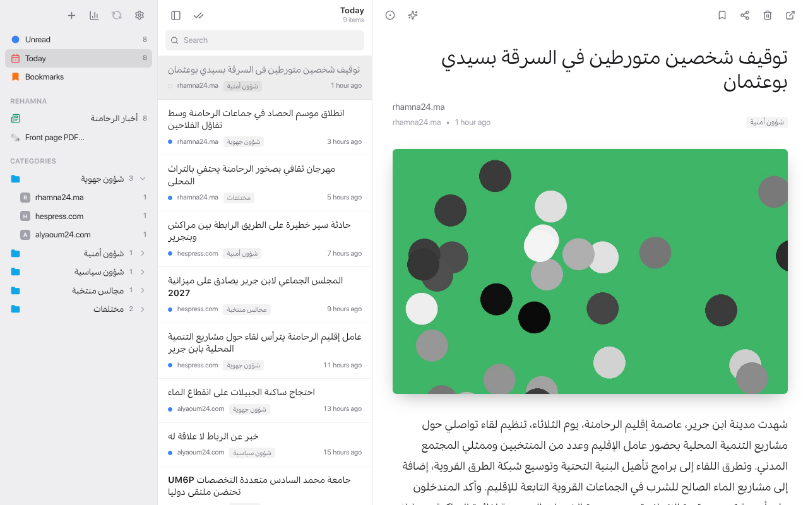
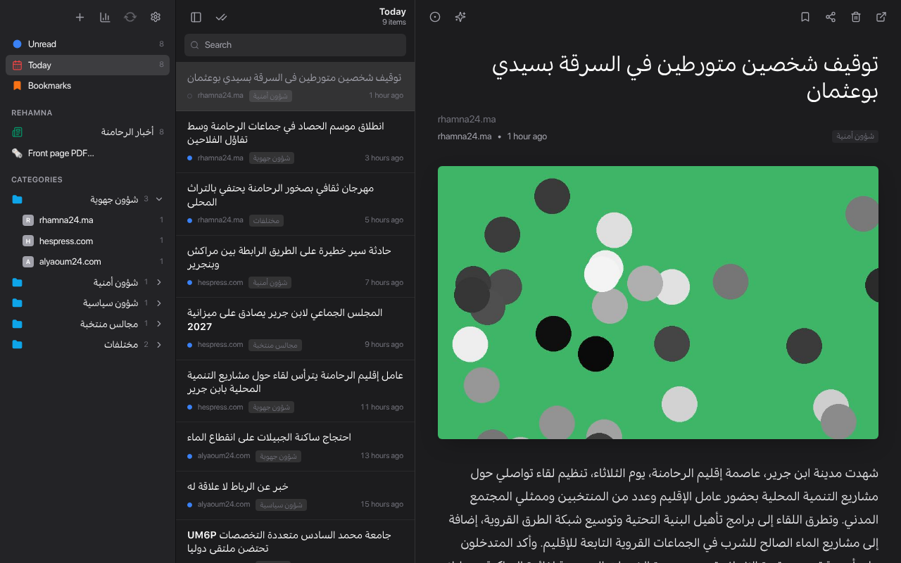
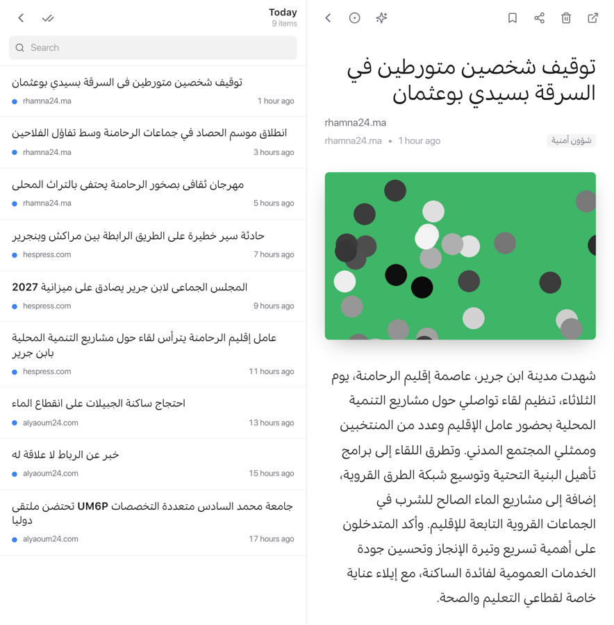
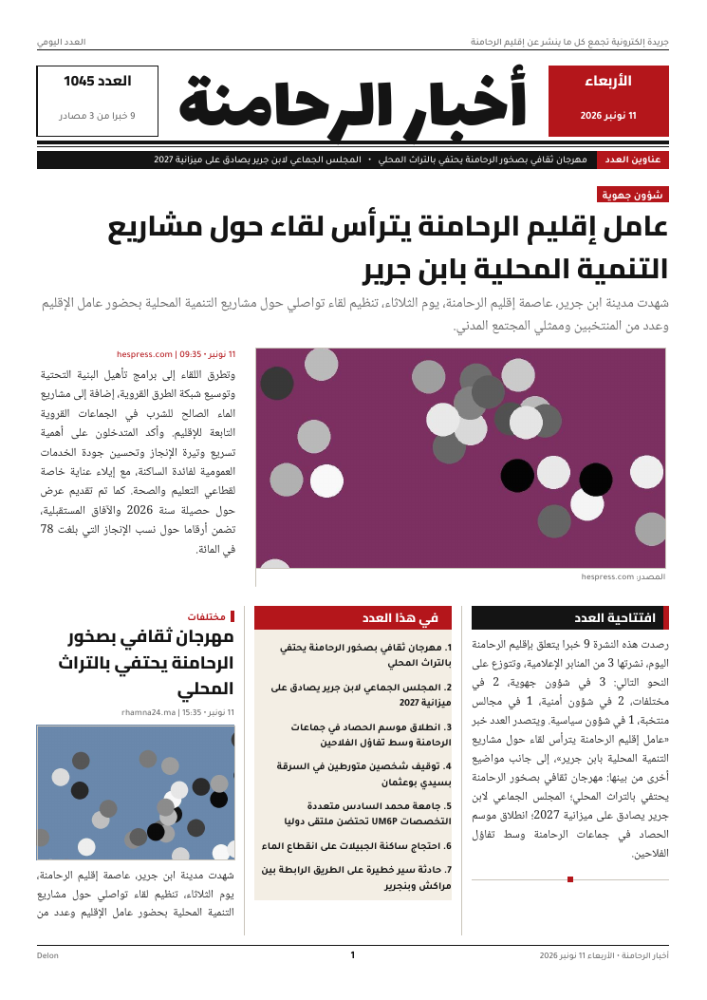

# 📰 Delon — Arabic News Reader, Classifier & Rehamna Newspaper

Delon is an **Arabic news aggregation, classification and analytics platform** built with
**Flask**, **SQLite**, **React** and **AI/NLP tools**. It collects news from RSS feeds
(up to ~100 websites in 10 minutes), classifies and summarizes Arabic articles, tracks
social shares, exports daily Excel/Word reports and generates a **front-page style PDF
newspaper of all news about Rehamna (الرحامنة)**.

It runs as a **website**, a **Windows app (`Delon.exe`)** and an **Android app (`Delon.apk`)**.



<p align="center">
  
  
</p>

---

## 📥 Download

| Platform | File | Where to get it |
|---|---|---|
| Windows 10/11 | `Delon.exe` | **Actions → Build Windows app → Artifacts** (or the release assets for a `v*` tag) |
| Android | `Delon.apk` | **Actions → Build Android app → Artifacts** (or the release assets for a `v*` tag) |
| Web / server | — | `python main.py` (see [Run from source](#-run-from-source)) |

Both apps are built automatically by GitHub Actions on every push to `main` (and `claude/**`
branches). Push a tag such as `v3.0.0` to publish them in a GitHub release.

---

## ✨ Features

### Three-pane reader
- **Sidebar**: Unread, Today, Bookmarks, the **أخبار الرحامنة** smart list, and your
  categories as folders that contain each news source (with site icon and unread count).
- **Article list**: bold unread titles, source, category and "x hours ago".
- **Reader**: large title, source, author • time, photo and comfortable Arabic typography.
- Toolbar: AI summary ✨, bookmark, share counts, delete, mark unread, open the original.
- Search, mark-all-as-read, light / dark / system theme.
- On phones the panes stack (sidebar → list → article) with back buttons.
- Read state and bookmarks are stored on the device.

### 🗞️ Rehamna front-page PDF

<p align="center"></p>

A newspaper built from every stored article that mentions Rehamna
(الرحامنة، ابن جرير، سيدي بوعثمان، صخور الرحامنة…):

- Masthead **أخبار الرحامنة** (Lalezar) with a red date box, issue number and a headlines strip.
- Typography like a printed Arabic daily: Cairo headlines, Noto Naskh body text, Tajawal labels,
  red category tags and hairlines between columns.
- **Lead story** with a large photo, then an **editorial** that summarizes all the news
  (written by AI when an OpenRouter key is configured, otherwise generated automatically).
- **"في هذا العدد"** index box, then 3 right-to-left columns of stories with photos,
  category, source and time. Continues on as many pages as needed.
- Photos come from the RSS image, the article's ``, or the page's `og:image`.
- Choose the period: **Today / 3 days / Week / Month**, and the maximum number of articles.
- Every generated PDF is archived in `reports/rehamna/YYYY/MM/`.
- Detection words are editable in [`json/rehamna.json`](json/rehamna.json).

In the app: **sidebar → Front page PDF…** (or the **PDF** button in the Rehamna list).

### Backend
1. **RSS aggregation** — safe parsing of malformed feeds, duplicate removal, SQLite storage.
2. **Arabic text processing** — HTML cleaning, Alef/Hamza/diacritics/Tatweel normalization.
3. **Classification** — weighted Arabic keywords + city detection into:
   شؤون أمنية · شؤون سياسية · شؤون جهوية · مجالس منتخبة · مختلفات
4. **AI summaries** (OpenRouter), cached for 24 hours.
5. **Keywords & places management** (`json/keywords.json`, `json/places.json`).
6. **Feed management** — add a website and Delon finds its RSS feed (`json/links.json`).
7. **Social share analytics** (SharedCount, optional).
8. **Daily Excel & Word reports** and feed-health reports.
9. **Analytics dashboard** (charts of sources, timeline, places, categories).

---

## 💻 Windows app

1. Download `Delon.exe` and double-click it — the backend starts and Delon opens in its own window.
2. Optional: put your `secret.env` **next to `Delon.exe`** to enable AI summaries / share counts.
3. Your data (database, feeds, keywords, reports, `delon.log`) is kept in `%APPDATA%\Delon`.

Command-line options:

| Option | Effect |
|---|---|
| `--lan` | Also listen on your Wi-Fi so the Android app can use this PC as its server (address shown in the window title) |
| `--port 5000` | Preferred port (the next free one is used if busy) |
| `--browser` | Open in your web browser instead of an app window |
| `--headless` | Run only the server |

> The window uses Microsoft Edge WebView2 (built into Windows 10/11). If it is missing,
> Delon opens in your browser instead.

## 📱 Android app

The phone shows the news, but the news engine (Python) runs on a server. On first launch,
enter your server address in **Settings**, then tap **Test connection**:

- a PC on the same Wi-Fi running `Delon.exe --lan` → e.g. `http://192.168.1.20:5000`
- or your online server (e.g. Render) → `https://your-app.onrender.com`

The APK is debug-signed: it installs directly (allow "install unknown apps"); a release
key is only needed to publish on the Play Store.

---

## 🔑 Configuration (`secret.env`)

```env
OPENROUTER_API_KEY=sk-or-...            # AI summaries + AI newspaper editorial (optional)
OPENROUTER_MODEL=openai/gpt-4o-mini     # any OpenRouter model id
SHARED_API_KEY=...                      # SharedCount share counts (optional)
```

Everything works without these keys; the related features are simply disabled.

---

## ▶️ Run from source

```bash
pip install -r requirements.txt
python main.py
```

Open http://localhost:5000 — Flask serves the compiled React app from `build/`.

Frontend development:

```bash
cd delon-frontend
npm ci
npm start          # http://localhost:3000, talks to the API on :5000
npm run build      # then copy delon-frontend/build → build/
```

### Build Delon.exe yourself (on Windows, Python 3.11)

```bash
cd delon-frontend && npm ci && npm run build && cd ..
rmdir /s /q build & xcopy /e /i delon-frontend\build build
pip install -r requirements-desktop.txt
pyinstaller delon.spec        # → dist\Delon.exe
```

### Build Delon.apk yourself (Android SDK + Java 21)

```bash
cd delon-frontend
npm ci && npm run build
npx cap add android           # first time only
npx cap sync android
cd android && ./gradlew assembleDebug
```

---

## 🔌 API

| Method | Endpoint | Description |
|---|---|---|
| GET | `/articles?days=1&category=&source=&q=` | Stored articles (fast) |
| GET | `/fetch-rss` | Fetch all feeds, classify and store today's news |
| GET | `/search?query=` | Search today's articles (`all`, or `1`–`5` for a category) |
| GET | `/rehamna/articles?days=7` | Articles related to Rehamna |
| GET | `/rehamna/newspaper.pdf?days=1&limit=40&ai=1&download=1` | Rehamna front-page PDF |
| GET | `/get-article-summary?article_id=` | AI summary |
| GET | `/get-share-counts?url=` | Social share counts |
| DELETE | `/delete?article_id=&article_title=` | Delete an article (and ignore it in future fetches) |
| POST | `/add-rss-feed` `{ "url": "…" }` | Find and add a website's RSS feed |
| GET | `/list-feeds`, `/check-feeds` | Feed list / health |
| GET/POST/DELETE | `/keywords/*`, `/places/*` | Manage keywords and places |
| GET | `/analytics/*` | Dashboard statistics |

---

## 🗂️ Project structure

```
main.py                 Flask API (aggregation, classification, reports)
newspaper_pdf.py        Rehamna newspaper PDF generator (ReportLab + Arabic shaping)
desktop.py              Desktop launcher used for Delon.exe
delon.spec              PyInstaller build recipe
json/                   Feeds, keywords, places, Rehamna terms
fonts/                  Newspaper fonts (OFL): Lalezar, Cairo, Noto Naskh Arabic, Tajawal
build/                  Compiled React app served by Flask
delon-frontend/         React + Tailwind source, Capacitor config for Android
assets/                 App icons and splash screen
.github/workflows/      Windows .exe and Android .apk builds
```

## 🛠️ Tech stack
Flask · SQLite · React · Tailwind CSS · Capacitor · PyInstaller · pywebview ·
ReportLab · arabic-reshaper · python-bidi · scikit-learn · OpenRouter · Pandas · OpenPyXL ·
python-docx · SharedCount

## 📌 Use cases
News monitoring · Arabic media analysis · Daily press reports · Local (Rehamna) press reviews ·
Social media impact tracking

## 📄 License
Private / Internal Use. The bundled fonts (Lalezar, Cairo, Noto Naskh Arabic, Tajawal) are
licensed under the SIL Open Font License — see `fonts/licenses/`.
