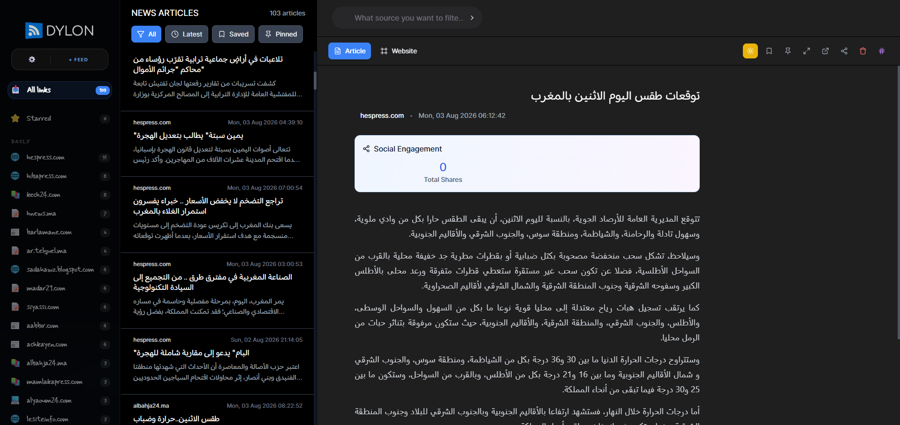

# 📰 Arabic News Aggregation & Analysis Platform

A full-featured **Arabic news aggregation, classification, summarization, and analytics platform** built with **Flask**, **SQLite**, and **AI/NLP tools**.  
The system automatically collects news from RSS feeds, processes Arabic content, classifies articles, generates summaries, tracks social media shares, and exports structured reports.
it can fo up to 100 websites in 10min

---
### Screenshot

## 🚀 Key Features

### 1. RSS News Aggregation
- Parses multiple RSS feeds safely (handles malformed XML).
- Avoids duplicate articles using titles and links.
- Stores articles in a local **SQLite database**.

### 2. Arabic Text Processing
- HTML cleaning with BeautifulSoup.
- Arabic normalization (Alef, Hamza, diacritics, Tatweel).
- Safe handling of long Arabic text for DB & Excel.

### 3. Intelligent Article Classification
Categories:
- شؤون أمنية
- شؤون سياسية
- شؤون جهوية
- مجالس منتخبة
- مختلفات

Uses weighted Arabic keywords, city detection, and optional AraBERT support.

### 4. AI Arabic Summarization
- Automatic Arabic summaries using AI (OpenRouter models).
- Cached for 24 hours.
- Multi-key retry system.

Endpoint:
GET /get-article-summary?article_id=UUID

### 5. Keyword Management
- List, add, delete keywords dynamically.
- Stored in json/keywords.json.

### 6. Places Management
- Location-based news detection.
- Stored in json/places.json.

### 7. Social Media Share Analytics
- Facebook & Pinterest share tracking via SharedCount.
- Cached for 4 hours.

### 8. Excel & Word Reports
- Daily Excel reports (before/after 10:30).
- Arabic-safe Excel export.
- Organized by year/month/day folders.

### 9. SQLite Database
Tables:
- articles
- deleted_articles
- command_logs

Thread-safe with WAL mode.

### 10. REST API & Frontend
- Flask REST API with CORS.
- React frontend served from /build.
- Swagger UI support.

---

## 🛠️ Tech Stack
- Flask, SQLite
- Transformers, Sentence-Transformers
- OpenRouter AI
- Pandas, OpenPyXL, python-docx
- SharedCount API

---

## ▶️ Run Project

```bash
pip install -r requirements.txt
python main.py
```

Server:
http://localhost:5000

---

## 🆕 Delon 3 — reader redesign, desktop & Android apps, Rehamna newspaper

### Three-pane reader
The UI is now a clean three-pane news reader (sidebar → article list → reader):
- **Smart lists**: Unread, Today, Bookmarks (read state and bookmarks are kept on the device).
- **Rehamna**: a smart list with every article that mentions الرحامنة / ابن جرير / سيدي بوعثمان…
- **Categories as folders**, with each news source (and its icon) inside, plus unread counts.
- Light / dark / system theme, search, AI summary, share counts, delete, open the original.
- On phones the panes stack (sidebar → list → article) with back buttons.

### 🗞️ Rehamna front-page PDF
Generates a newspaper-style PDF (masthead, lead story with a big photo, an editorial,
an "in this issue" box, then 3 right-to-left columns of stories with photos).

- In the app: sidebar → **Front page PDF…** (choose Today / 3 days / Week / Month).
- API: `GET /rehamna/newspaper.pdf?days=1&limit=40&ai=1&download=1`
- Matching articles as JSON: `GET /rehamna/articles?days=7`
- Detection terms are editable in `json/rehamna.json`.
- With `OPENROUTER_API_KEY` + `OPENROUTER_MODEL` in `secret.env`, the editorial is written by AI
  from all the Rehamna stories; otherwise an automatic summary is used.
- Photos come from the RSS image, the `` in the article, or the page's `og:image`.
- A copy is archived in `reports/rehamna/YYYY/MM/`.

### 💻 Windows app (`Delon.exe`)
Built automatically by GitHub Actions (**Actions → Build Windows app → Artifacts**, or attached to a
release when you push a tag like `v3.0.0`).

- Double-click `Delon.exe`: it starts the backend and opens Delon in its own window.
- Your data (database, feeds, keywords, reports) lives in `%APPDATA%\Delon`.
- Put your `secret.env` next to `Delon.exe` for the AI / SharedCount keys.
- `Delon.exe --lan` also listens on your Wi-Fi so the Android app can use this PC as its server
  (the address is shown in the window title).

Build it yourself on Windows:
```bash
cd delon-frontend && npm ci && npm run build && cd ..
rmdir /s /q build & xcopy /e /i delon-frontend\build build
pip install -r requirements-desktop.txt
pyinstaller delon.spec        # → dist\Delon.exe
```

### 📱 Android app (`Delon.apk`)
Built automatically by GitHub Actions (**Actions → Build Android app → Artifacts**).
On first launch, enter your Delon server address, e.g. `http://192.168.1.20:5000`
(a PC running `Delon.exe --lan` or `python main.py`) or your online server URL.

Build it yourself (needs Android Studio / SDK + Java 21):
```bash
cd delon-frontend
npm ci && npm run build
npx cap add android      # first time only
npx cap sync android
cd android && ./gradlew assembleDebug
```

---

## 📌 Use Cases
- News monitoring
- Arabic media analysis
- Daily press reports
- Social media impact tracking

---

## 📄 License
Private / Internal Use
"# Delon---News-Feed" 
